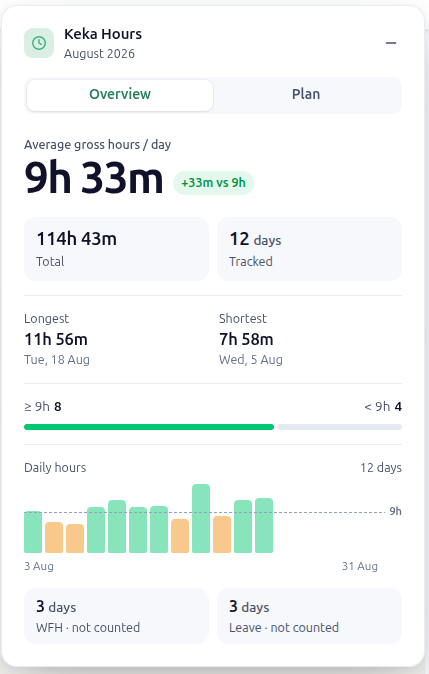
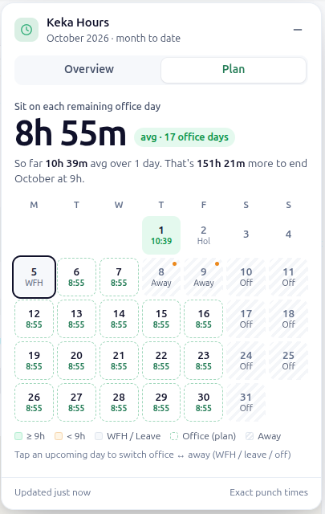
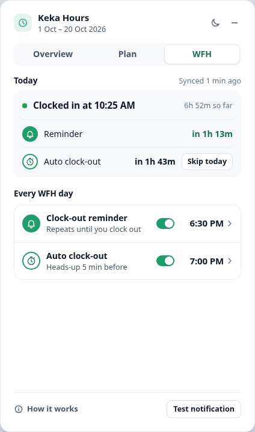
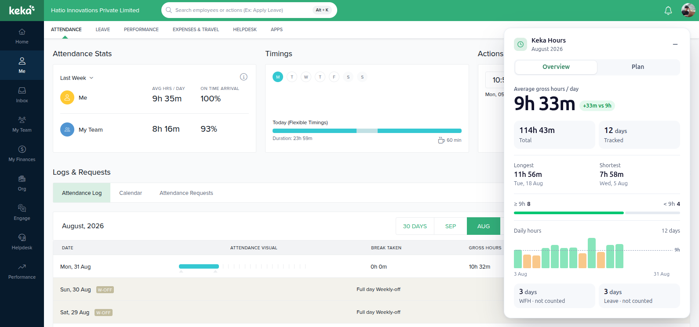

# Keka Hours

A small Chrome extension for Keka (`hatio.keka.com → Me → Attendance`):

- your **average office hours per day** for the month you're viewing, and how long to sit on the
  remaining days to stay at 9h+;
- a **clock-out reminder on WFH days**, so Keka doesn't mark a missed clock-out;
- optional **auto clock-out** at a time you choose.

Everything runs locally in your browser. Nothing is sent anywhere.

<table>
  <tr>
    <th>Overview</th>
    <th>Plan</th>
    <th>WFH</th>
  </tr>
  <tr>
    <td></td>
    <td></td>
    <td></td>
  </tr>
</table>

<p align="center">
  
  <br><sub>Sits bottom-right on Keka's Attendance Log, following Keka's theme colour.</sub>
</p>

## Install (unpacked)

1. Download/unzip this folder.
2. Open `chrome://extensions` and turn on **Developer mode** (top-right).
3. Click **Load unpacked** and select the `keka-hours` folder (the one containing `manifest.json`).
4. Open (or reload) https://hatio.keka.com/#/me/attendance/logs.

The card appears only on the Attendance Log page and is removed as soon as you navigate anywhere else.

A compact card appears bottom-right. Click it for details. The daily target is fixed at the
company standard of **9h 00m**.

The card follows Keka's own **Display mode** (light / dark), and switches when you change it in
Keka. The moon/sun button in the card's header overrides it. The override is remembered (and shared
between Keka tabs) until you pick Keka's mode again or change Keka's display mode. If Keka's mode
can't be read, the card follows your OS setting.

- **Overview**: average, total, tracked days, longest/shortest, days ≥ / < 9h, WFH / leave.
  Click the ⓘ next to "Office hours avg this month" to see every day behind it in a pop-up: date,
  type (office / WFH / leave / week-off…) and hours, with counted days highlighted, and
  total ÷ counted days. The list scrolls for long months.
  Today is left out of every Overview figure, the chart, and the minimised pill unless you turn on
  **Include today** (off by default). Only turn it on once you've clocked out and today's hours show in
  the attendance table (hovering the switch reminds you). The Plan tab always uses today. The setting is remembered.
- **Plan**: a month calendar showing how long to sit on each remaining office day to end the
  month at a 9h+ average. Weekdays count as office days by default, and weekends and
  Keka-known holidays don't. Tap any upcoming day to switch it between office and away
  (WFH / leave / off). Your choices are saved locally per month. If you're clocked in today with
  a single punch, it also shows the time you can clock out.
- **WFH**: the **Auto clock-out** card on top, then one **Clock-out reminder** box: your clock-in
  status, today's reminder (with snooze / stop controls), the **reminder time slider**, and the two
  rules. **Send test reminder** at the bottom. Details below.

### WFH clock-out reminders

Keka hides the clock-out button 12 hours after your first clock-in and marks a missed clock-out.
Office attendance is biometric, so a web **WFH Clock-In** means a WFH day, whether or not the WFH
request is approved yet.

- **When:** once you're clocked in via the web, a system notification reminds you at **6:30 PM**. It
  appears whichever tab or app you're in, even with Keka closed. A low-key notification confirms
  when a reminder is set after you clock in.
- **Setting the time:** drag the slider in the WFH tab (or click anywhere on it): 12 PM to 8 PM in
  half hours. It saves when you let go. With the keyboard: ← → 30 min, PgUp / PgDn 1 h, Home / End.
  **Custom time** opens a picker for any other time up to **10:00 PM** (e.g. 8:45 PM); a time past
  8 PM shows at the slider's end as "9:30 PM ›". The time applies on every WFH day. While you're
  clocked in, the slider also shows how far into the day you are, with a tick at "now".
- **A time that has already passed today** (for the reminder or auto clock-out) starts on your next
  WFH day; today keeps the time it had, so you never get an instant reminder or a surprise
  clock-out. The tab and the pop-ups say so as soon as you pick it.
- **Safety net:** if 11h after your first clock-in comes earlier than your reminder time, you're
  reminded then instead.
- **Late clock-in:** if you clock in (or back in from a break) after the reminder time, you're
  reminded 30 min later.
- **Repeats:** the reminder stays on screen and repeats every 15 min until you clock out. Click it
  to open Keka. Its buttons: **Snooze 30 min** and **Stop for today**. In the WFH tab, **+15 min**
  extends a snooze, **Cancel snooze** reminds you now, and **Turn back on** undoes a stop.
- **Hard limit:** 10:00 PM. Reminders can't be set or snoozed past it, and they stop quietly there
  (or at Keka's 12h cutoff if that's earlier). Clocking out stops them at once.
- **Toolbar badge:** the extension icon counts down to the reminder. It turns amber while snoozed
  and red **OUT** once it's time.

### Auto clock-out (optional)

Off by default. Set it up from the **Auto clock-out** card at the top of the WFH tab (**Set up** /
**Edit** opens a pop-up): a time (default 30 min after your reminder, up to 10:00 PM) that applies
on every WFH day.

- 5 min before, a notification lets you **Skip today** or add **+15 min**. There's always this
  heads-up: if the time has already passed (your laptop was asleep, or you pressed Reset), it warns
  you first and runs 5 min later.
- **Reset** on the Auto clock-out card clears today's skip, +15 min or result, so it runs again.
- At the time, the extension opens Keka Attendance in a background tab, clicks **WFH Clock-out** and
  then **Clock-out** (Keka's own confirm), and closes the tab. Keka sends its usual request; the
  extension never builds one or reads your login.
- It confirms from Keka's response and tells you "Clocked out at 7:00 PM". If anything is off
  (signed out, different buttons, no response in 90 s), it stops and shows an on-screen alert to
  clock out yourself.
- It runs at most once a day, only if you're clocked in then and clocked in before that time, and
  never later than 11h after your first clock-in or 10:00 PM.
- It needs Chrome running, your laptop awake, and you signed in to Keka.

The extension sees clock-ins and clock-outs when you click WFH Clock-In / Clock-out on Keka web, and
whenever a Keka Attendance page loads (so a clock-in from the mobile app is picked up the next time
you open Keka web). Chrome must be running, and your OS must allow Chrome notifications (use **Send
test reminder** in the WFH tab to check).

In the **30 DAYS** tab the card shows the current month to date (1st → today), not the rolling
30 days.

## What counts

A day counts toward the average only if it is **not WFH**, **not Leave**, and has **tracked time > 0**.

| Day                                      | Counted? |
| ---------------------------------------- | -------- |
| Office day with time                     | ✅       |
| Holiday / weekly-off where you clocked in | ✅ (e.g. comp-off work) |
| WFH (any day, any hours)                 | ❌       |
| Leave (even if some time shows)          | ❌       |
| W-OFF / holiday / absent with 0h         | ❌       |
| Today                                    | ❌ unless **Include today** is on (and then only once you've clocked out) |

There's no Monday–Friday logic. The attendance record decides.

## Precision and rounding

Keka's table shows minute-rounded hours. Keka's own attendance response, which the page already
loads, includes the exact punch timestamps. The extension reads a copy of that one response and
uses the exact durations. It does this only when they match Keka's own total for that day **and**
the minute value currently shown in the table. Otherwise it uses the displayed (minute-rounded)
value for that day.

Rounding matches HR: each day's seconds are dropped, and the average is truncated, never rounded
up. Rounding up would often show 1 minute more than HR reports.
Truncating also means the card never shows you meeting the target when you're a few seconds short.

### Plan accuracy

The plan uses the same HR rules: days count in whole minutes and the average is truncated, so
`avg ≥ 9h ⟺ total ≥ 9h × days`. The figure shown is
`ceil((9h × (counted + remaining) − counted total) / remaining)`. Sitting that long on every
remaining office day ends the month at 9h or above, and one minute less doesn't (tested). It's
only as accurate as the calendar, so mark WFH / leave days.

## Privacy

- Permissions: `storage` (which upcoming days you marked away/office in Plan, your theme override,
  Include today, your reminder and auto clock-out settings, and today's WFH punch times), `alarms`
  and `notifications` (clock-out reminders). No `tabs`, `cookies`, `webRequest`, or host
  permissions. Auto clock-out opens and closes its own Keka tab, which needs no extra permission.
- Runs only on `https://hatio.keka.com/*`.
- Never makes network requests. It doesn't read credentials, tokens, or cookies. If you turn on
  auto clock-out, it clicks Keka's own WFH Clock-out / Clock-out buttons in a background tab it
  opens for that, and Keka sends its usual request.
- It reads only Keka's responses from `/attendance/api/mytime/attendance/summary/*`,
  `workingremotelyclockin` (the WFH Clock-In / Clock-out click) and `attendancedayrequests` (the
  Actions card). It keeps only dates, status flags, durations, and punch times, and drops locations,
  IPs, notes, and ids. It never reads request bodies (the clock-in request carries your location).
- Attendance data lives only in memory on that page. The exception is today's WFH punch times,
  stored locally so reminders still fire after the tab is closed. Only today's are kept.

## How it stays current

The card re-reads the attendance table when any of these happen: URL changes (including Angular's `pushState` navigations, which fire no hash events), attendance-area
DOM changes (debounced 300 ms), Keka reloading its attendance data, tab focus or visibility, and
expanding the card. It also re-checks once a minute while the tab is visible. A signature of the
parsed data means it re-renders only when something actually changed. If the month header
changes before Keka has replaced the rows, the card shows **Updating…** and never the previous
month's numbers.

## Project layout

```
manifest.json
src/page/network-hook.js     MAIN world: passive copy of Keka's attendance summary + WFH punch responses
src/content/parser.js        DOM snapshot + pure normalisation/merge → AttendanceDay[]
src/content/calculator.js    pure calculateSummary(days, targetMinutes)
src/content/format.js        display formatting
src/content/planner.js       pure planMonth(): required minutes per remaining office day
src/content/settings.js      chrome.storage.local (plan overrides, theme, Include today, WFH settings)
src/content/ui.js            Shadow-DOM widget (minimised pill + expanded card)
src/content/main.js          controller: events, debouncing, signatures, freshness
src/content/autoclock.js     auto clock-out: the two clicks on Keka's Actions card
src/shared/wfh.js            pure WFH clock-out reminder rules (worker + WFH tab)
src/background/service-worker.js  alarms, notifications, toolbar badge, auto clock-out tab
tests/                       node --test unit tests
```

Run tests: `npm test` (or `node --test tests/`). Requires Node 18+.

## Known limitations

- Keka's numeric codes are inferred from real data, not documented: `dayType` 1 = holiday,
  2 = weekly-off; `attendanceDayStatus` 2 = WFH. The table badges (Wfh / Leave / HLDY / W-OFF)
  are checked as well.
- If Keka changes its markup or API, the card falls back to "Waiting for attendance" instead of
  showing wrong numbers. The parser may then need updating.
- A half-day leave combined with a half-day WFH or office day is excluded entirely.
